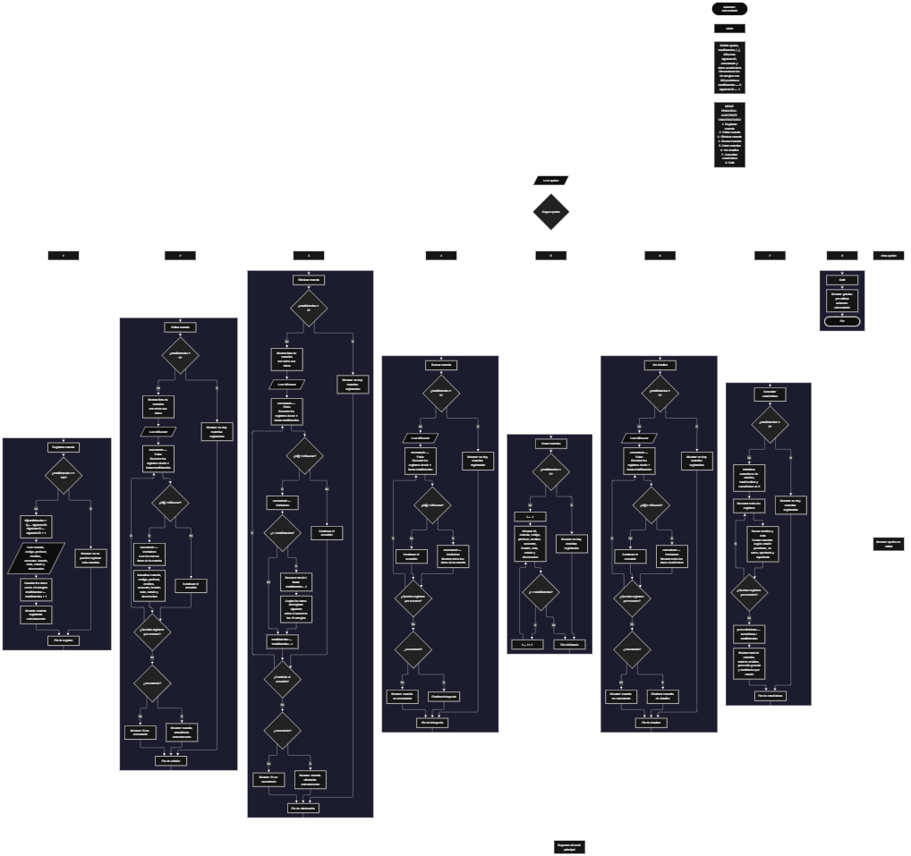

 

Este proyecto, llamado <b>asistente universitario</b>, fue desarrollado en <b>pseint</b> como un ejercicio práctico para fortalecer la lógica de programación mediante la creación de un sistema de gestión de materias universitarias desde la consola. El programa cuenta con un menú principal de ocho opciones que permite <b>registrar, editar, eliminar, buscar, listar, consultar los detalles y mostrar estadísticas</b> de las materias registradas. Cada materia almacena información como el nombre, el código, el profesor, los créditos, el semestre, el horario, la nota, el estado y una observación, utilizando arreglos con una capacidad máxima de <b>100 materias durante la ejecución</b>. Durante su desarrollo se aplicaron conceptos fundamentales de programación, como variables, arreglos, estructuras condicionales, ciclos repetitivos y estructuras de selección, además de procesos para buscar, modificar, eliminar y organizar registros. El programa también permite calcular el total de créditos, el promedio general de notas y la cantidad de materias según su estado académico. Este proyecto permite poner en práctica los conocimientos adquiridos en PSeInt y sirve como base para desarrollar sistemas de gestión académica más avanzados utilizando otros lenguajes y tecnologías.

<h2 align="center">⚙️ Funcionamiento del menú principal</h2>

### ➕ Registrar materia

La opción <b>1) registrar materia</b> permite agregar una nueva materia al sistema. Antes de realizar el registro, el programa comprueba que la cantidad de materias almacenadas sea menor a <b>100</b>, mediante la condición <b>totalmaterias &gt;= 100</b>, que identifica cuándo se alcanzó la capacidad máxima. Si todavía existe espacio disponible, asigna un identificador utilizando el arreglo <b>id</b> y la variable <b>siguienteid</b>, que aumenta en uno después de cada asignación. A continuación, solicita el <b>nombre de la materia, código, profesor, cantidad de créditos, semestre, horario, nota, estado y observación</b>. Los datos se almacenan en la posición correspondiente de sus respectivos arreglos. Finalmente, aumenta la variable <b>totalmaterias</b> en uno y muestra el mensaje <b>"materia registrada correctamente."</b>. Si se alcanza la capacidad máxima, presenta el mensaje <b>"no se pueden registrar mas materias."</b>, impidiendo agregar otro registro.

### ✏️ Editar materia

La opción <b>2) editar materia</b> permite modificar la información de una materia registrada. Primero, el programa comprueba si existen materias almacenadas mediante la variable <b>totalmaterias</b>. Si no hay registros, muestra el mensaje <b>"no hay materias registradas."</b>. En caso contrario, presenta una lista con el identificador, nombre, código, profesor, créditos, semestre, horario, nota, estado y observación de cada materia. Después, solicita el identificador de la materia que se desea editar y utiliza la variable lógica <b>encontrado</b>, inicializada en <b>falso</b>, para indicar si localiza una coincidencia. Mediante un ciclo <b>para</b>, recorre los registros y compara el identificador almacenado con el valor introducido. Si encuentra la materia, cambia <b>encontrado</b> a <b>verdadero</b> y solicita los nuevos datos para actualizar los arreglos correspondientes. Finalmente, muestra el mensaje <b>"materia editada correctamente."</b>. Si termina el recorrido sin encontrar el identificador, presenta el mensaje <b>"no se encontro una materia con ese id."</b>.

### 🗑️ Eliminar materia

La opción <b>3) eliminar materia</b> permite eliminar una materia mediante su identificador. Antes de comenzar, el programa comprueba que existan materias registradas. Si la lista está vacía, muestra el mensaje <b>"no hay materias registradas."</b>. Si existen registros, presenta una lista con la información de las materias y solicita el identificador que se desea eliminar. Después, inicializa la variable <b>encontrado</b> en <b>falso</b> y recorre los registros para localizar la coincidencia. Cuando encuentra el identificador, cambia la variable a <b>verdadero</b>. Si la posición seleccionada es menor que <b>totalmaterias</b>, utiliza un ciclo <b>para</b> controlado por la variable <b>j</b> para desplazar los datos de las materias posteriores una posición hacia atrás en los diez arreglos: <b>id, materia, codigo, profesor, creditos, semestre, horario, nota, estado y observacion</b>. Posteriormente, disminuye <b>totalmaterias</b> en uno y muestra el mensaje <b>"materia eliminada correctamente."</b>. Si no encuentra el identificador, presenta el mensaje <b>"no se encontro una materia con ese id."</b>. El código no limpia explícitamente la última posición después del desplazamiento y continúa el recorrido tras encontrar una coincidencia.

### 🔎 Buscar materia

La opción <b>4) buscar materia</b> permite localizar una materia mediante su identificador. Primero, el programa comprueba si existen materias registradas. Si no hay registros, muestra el mensaje <b>"no hay materias registradas."</b>. En caso contrario, solicita el identificador de la materia que se desea buscar e inicializa la variable lógica <b>encontrado</b> con el valor <b>falso</b>. A continuación, utiliza un ciclo <b>para</b> para recorrer los identificadores almacenados y compararlos con el valor introducido mediante la condición <b>id[i] = idbuscar</b>. Cuando encuentra una coincidencia, cambia la variable <b>encontrado</b> a <b>verdadero</b> y muestra todos los datos de la materia: identificador, nombre, código, profesor, créditos, semestre, horario, nota, estado y observación. Si finaliza el recorrido sin encontrar coincidencias, presenta el mensaje <b>"no se encontro una materia con ese id."</b>. La búsqueda no interrumpe explícitamente el ciclo después de encontrar una coincidencia.

### 📋 Listar materias

La opción <b>5) listar materias</b> permite visualizar las materias registradas en el sistema. Antes de mostrar la información, el programa comprueba si la variable <b>totalmaterias</b> es igual a cero. Si no existen registros, presenta el mensaje <b>"no hay materias registradas."</b>. Si hay materias disponibles, muestra el encabezado <b>"datos registrados"</b> y utiliza un ciclo <b>para</b> para recorrer los arreglos desde la primera posición hasta el total actual de materias. Durante el recorrido, muestra el identificador, nombre, código, profesor, créditos, semestre, horario, nota, estado y observación de cada registro. Esta función permite consultar las materias almacenadas sin tener que buscarlas individualmente.

### 📄 Ver detalles de la materia

La opción <b>6) ver detalles de la materia</b> permite consultar la información completa de una materia específica. Primero, el programa comprueba si existen materias registradas. Si la lista está vacía, muestra el mensaje <b>"no hay materias registradas."</b>. En caso contrario, solicita el identificador de la materia que se desea consultar e inicializa la variable <b>encontrado</b> en <b>falso</b>. Después, recorre los registros mediante un ciclo <b>para</b> y compara cada identificador con el valor introducido. Si encuentra una coincidencia, cambia la variable a <b>verdadero</b> y muestra los datos completos de la materia: <b>id, materia, código, profesor, créditos, semestre, horario, nota, estado y observación</b>. Si termina el recorrido sin encontrar el identificador, presenta el mensaje <b>"no se encontro una materia con ese id."</b>.

### 📊 Mostrar estadísticas

La opción <b>7) mostrar estadísticas</b> permite obtener un resumen de la información académica almacenada. Primero, el programa comprueba si existen materias registradas. Si no hay registros, muestra el mensaje <b>"no hay materias registradas."</b>. Si existen materias, inicializa en cero los contadores <b>totalpendientes, totalencurso, totalaprobadas, totalreprobadas y totalcreditos</b>, además del acumulador <b>sumanotas</b>. A continuación, utiliza un ciclo <b>para</b> para recorrer las materias, sumar los créditos de cada registro y acumular sus notas. También compara el valor de <b>estado[i]</b> con las categorías <b>"pendiente", "en curso", "aprobada" y "reprobada"</b>, incrementando el contador correspondiente cuando encuentra una coincidencia. Al terminar el recorrido, calcula el promedio general mediante la operación <b>sumanotas / totalmaterias</b>. Finalmente, muestra el total de materias, los créditos acumulados, el promedio general de notas y las cantidades de materias según su estado. Los contadores y acumuladores utilizados en esta opción se emplean en el código, pero no aparecen en las declaraciones iniciales de variables.

### 🚪 Salir del menú principal

La opción <b>8) salir</b> está destinada a finalizar la ejecución del programa y muestra el mensaje <b>"gracias por utilizar asistente universitario."</b>. El menú principal se encuentra dentro de una estructura repetitiva <b>repetir ... hasta que</b>, que mantiene el programa en funcionamiento mientras se realizan las operaciones disponibles. En este caso, la condición final es <b>hasta que opcion = 8</b>, por lo que seleccionar la opción 8 termina el ciclo y permite finalizar el algoritmo.

<h2 align="center">🧠 Temas aplicados en el proyecto</h2>

### 📦 Variables

En este proyecto se utilizan variables para controlar la opción seleccionada en el menú, contar las materias registradas, recorrer los arreglos, almacenar el identificador que se desea buscar y comprobar si se encontró una materia. También se utilizan variables auxiliares para calcular estadísticas académicas, acumular créditos y notas y contar las materias según su estado. Cada variable cumple una función específica dentro de las operaciones del sistema.

🔢 **Opcion:** Almacena la opción seleccionada por el usuario en el menú principal.

📊 **TotalMaterias:** Almacena la cantidad actual de materias registradas.

🔄 **I:** Funciona como contador en los ciclos <b>para</b> y permite recorrer los registros.

🔁 **J:** Controla el desplazamiento de los datos durante la eliminación de una materia.

🆔 **IdBuscar:** Almacena el identificador introducido por el usuario para localizar una materia.

🔢 **SiguienteID:** Genera los identificadores consecutivos de las nuevas materias.

✅ **Encontrado:** Variable lógica que indica si se encontró la materia solicitada.

📚 **TotalCreditos:** Acumula la cantidad de créditos de todas las materias registradas.

🧮 **SumaNotas:** Acumula las notas de las materias para calcular el promedio general.

📈 **PromedioNotas:** Almacena el resultado de dividir la suma de notas entre el total de materias.

📊 **TotalPendientes, TotalEnCurso, TotalAprobadas y TotalReprobadas:** Cuentan las materias según el estado académico registrado.

### 🗃️ Arreglos

En este proyecto se utilizan diez arreglos relacionados con los datos de cada materia. Cada arreglo tiene una capacidad de <b>100 posiciones</b> y utiliza el mismo índice para representar la información correspondiente a una misma materia. Por ejemplo, los datos de una materia almacenada en la posición <b>1</b> se encuentran distribuidos entre <b>id[1], materia[1], codigo[1], profesor[1], creditos[1], semestre[1], horario[1], nota[1], estado[1] y observacion[1]</b>. Esta organización permite recorrer, buscar, modificar, mostrar y eliminar materias utilizando posiciones relacionadas.

🆔 **Id[100]:** Almacena los identificadores de las materias.

📚 **Materia[100]:** Almacena los nombres de las materias.

🔤 **Codigo[100]:** Almacena los códigos de las materias.

👨‍🏫 **Profesor[100]:** Almacena los nombres de los profesores.

🔢 **Creditos[100]:** Almacena la cantidad de créditos de cada materia.

🎓 **Semestre[100]:** Almacena el semestre correspondiente a cada materia.

🕒 **Horario[100]:** Almacena los horarios de las materias.

📝 **Nota[100]:** Almacena las notas de las materias como valores reales.

📌 **Estado[100]:** Almacena el estado académico de cada materia.

📄 **Observacion[100]:** Almacena las observaciones relacionadas con cada materia.

### 🔀 Estructuras condicionales

En este proyecto se utilizan las estructuras <b>si</b> y <b>sino</b> para comprobar si se alcanzó la capacidad máxima de los arreglos, verificar si existen materias registradas antes de realizar determinadas operaciones y determinar si se encontró el identificador solicitado. También se utilizan condiciones para comprobar si una materia corresponde a alguno de los estados académicos contemplados en las estadísticas. Estas estructuras permiten que el programa responda de manera diferente según la situación de los registros y el resultado de cada operación.

### 🔄 Estructuras repetitivas

En este proyecto se utilizan los ciclos <b>para</b> y <b>repetir ... hasta que</b>. Los ciclos <b>para</b> permiten recorrer los arreglos para mostrar las materias, buscar identificadores, editar registros y calcular las estadísticas académicas. Durante la eliminación, también se utilizan para desplazar los datos de las materias posteriores una posición hacia atrás. Por otro lado, el ciclo <b>repetir ... hasta que</b> mantiene activo el menú principal hasta que el usuario selecciona la opción <b>8) salir</b>.

### 🎯 Estructura según

El programa evalúa el valor almacenado en la variable <b>opcion</b> mediante la estructura <b>segun</b> y ejecuta el bloque de instrucciones correspondiente. Cada caso representa una operación específica del sistema: <b>registrar, editar, eliminar, buscar, listar, ver detalles, mostrar estadísticas o salir</b>. También se utiliza el bloque <b>de otro modo</b> para mostrar el mensaje <b>"opcion no valida."</b> cuando el valor introducido no coincide con ninguna de las opciones definidas en el menú.

### 🔢 Dimensionamiento de arreglos

El programa utiliza la instrucción <b>dimension</b> para establecer la capacidad de los arreglos que almacenan la información de las materias. Se definieron <b>100 posiciones</b> para cada uno de los diez arreglos, lo que permite administrar hasta 100 materias durante la ejecución. La cantidad de posiciones ocupadas se controla mediante la variable <b>totalmaterias</b>, por lo que las operaciones recorren los registros comprendidos entre la primera posición y el total actual de materias.

### 🔄 Reorganización de registros

Cuando se selecciona una materia para eliminarla, el programa utiliza un ciclo <b>para</b> que comienza en la posición seleccionada y llega hasta <b>totalmaterias - 1</b>. En cada repetición, los datos de la posición siguiente se copian sobre la posición actual en los diez arreglos: <b>id, materia, codigo, profesor, creditos, semestre, horario, nota, estado y observacion</b>. Después, la variable <b>totalmaterias</b> disminuye en uno. El código no limpia explícitamente la última posición ocupada tras el desplazamiento, aunque esa posición queda fuera del rango de registros activos que determina el contador cuando la eliminación se completa correctamente.

<h2 align="center">¿Cómo se implementaron las operaciones crud en el proyecto?</h2>

Las operaciones <b>crud</b> se implementaron mediante las opciones del menú principal, permitiendo administrar las materias registradas. La operación <b>crear</b> corresponde a <b>registrar materia</b>, donde se introducen los datos de una nueva asignatura; <b>leer</b> se realiza mediante las opciones <b>buscar materia, listar materias y ver detalles de la materia</b>; <b>actualizar</b> corresponde a <b>editar materia</b>, donde se modifican los datos de una materia registrada; y <b>eliminar</b> se realiza mediante la opción <b>eliminar materia</b>. Estas operaciones utilizan variables, arreglos, condicionales y ciclos para gestionar la información almacenada temporalmente durante la ejecución del programa.

<h2 align="center">Diagrama de flujo del proyecto</h2>

<h2 align="center">🛡️ Validaciones del programa</h2>

### 📭 No existen materias registradas

Esta comprobación se utiliza en las opciones de <b>editar, eliminar, buscar, listar, ver detalles y mostrar estadísticas</b>. El programa comprueba si la variable <b>totalmaterias</b> es igual a <b>0</b> y, si no existen materias registradas, muestra el mensaje <b>"no hay materias registradas."</b>. Esta comprobación evita continuar con las operaciones que necesitan registros almacenados cuando la lista está vacía.

### ⚠️ Capacidad máxima alcanzada

Esta comprobación se utiliza durante el registro de nuevas materias para controlar la capacidad máxima de los arreglos. El programa verifica si <b>totalmaterias &gt;= 100</b> antes de permitir agregar otro registro. Si se alcanza la capacidad máxima, muestra el mensaje <b>"no se pueden registrar mas materias."</b>. Si todavía existe espacio, permite ingresar los datos y aumenta el contador de materias registradas.

### ❌ Materia no encontrada

Esta comprobación se utiliza durante las operaciones de <b>editar, eliminar, buscar y ver detalles</b>. El programa inicializa la variable lógica <b>encontrado</b> con el valor <b>falso</b> y recorre el arreglo <b>id</b> para comparar los identificadores con el valor introducido por el usuario. Cuando encuentra una coincidencia, cambia la variable a <b>verdadero</b> y ejecuta la operación correspondiente. Si al finalizar el recorrido la variable continúa siendo <b>falso</b>, muestra el mensaje <b>"no se encontro una materia con ese id."</b>.

### 🔢 Datos académicos ingresados

Durante el registro y la edición, el programa solicita el nombre de la materia, el código, el profesor, los créditos, el semestre, el horario, la nota, el estado y la observación. Para el estado, presenta las categorías <b>"pendiente", "en curso", "aprobada" y "reprobada"</b>. Sin embargo, el código no incorpora condiciones que comprueben que el estado introducido pertenezca a una de esas categorías, ni valida rangos específicos para créditos, semestre o nota. Por ello, las estadísticas cuentan los estados que coinciden exactamente con los textos contemplados en el programa.

### ⚠️ Opción inválida

La estructura <b>segun</b> incluye el bloque <b>de otro modo</b>, que muestra el mensaje <b>"opcion no valida."</b> cuando el usuario introduce un valor que no corresponde a ninguna de las ocho opciones definidas en el menú. De esta manera, el programa informa que la selección no es válida y vuelve a presentar el menú mientras la condición de salida <b>opcion = 8</b> no se cumpla.

<h2 align="center">🎯 Objetivo del proyecto</h2>

El objetivo principal de este proyecto es fortalecer la <b>lógica de programación</b> mediante el desarrollo de un sistema de gestión de materias universitarias en <b>pseint</b>. A través de su construcción se busca aplicar los conocimientos adquiridos sobre variables, arreglos, estructuras condicionales, ciclos repetitivos y estructuras de selección, integrándolos para resolver un problema de organización académica. Además, el proyecto permite comprender cómo registrar, consultar, modificar y eliminar información, así como procesar datos para obtener estadísticas sobre créditos, notas y estados académicos. De esta manera, constituye una base para desarrollar sistemas de gestión universitaria más completos utilizando otros lenguajes y tecnologías.

